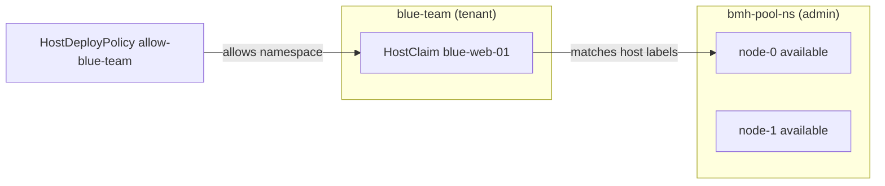

# HostClaims demo — presentation plan

A plan for a recorded talk about the Metal3 HostClaims feature. The demo
uses the samples in this folder:

- [hostdeploypolicy.yaml](hostdeploypolicy.yaml) — the admin rule.
- [hostclaim.yaml](hostclaim.yaml) — the tenant request.

## Assumptions

- Slot: about 8 minutes. This is one part of a larger talk.
- One short demo only: apply the CRs and show the host bind.
- Audience: platform engineers who know `BareMetalHost` but not `HostClaim`.
- Delivery: recorded demo. Pre-stage the setup. Start the recording at the
  apply steps.
- Namespaces: `bmh-pool-ns` holds the hosts. `blue-team` is the tenant.

## The idea in one line

`HostDeployPolicy` is the admin rule. `HostClaim` is the tenant request.
A host binds only when both sides agree.



## Use cases

- **Bare Metal as a Service.** Tenants request a host on demand.
- **CI and test pools.** A pipeline claims a host, runs, then releases it.
- **CAPI host pools.** Many clusters draw hosts from one shared pool.
- **Separation of duties.** The hardware team holds BMC secrets. App teams
  never see them.
- **Lab and reservation.** Reserve a host class for a test.
- **Edge.** A central inventory. Site teams claim local hosts.

## Slide plan and timing (8-minute part)

| # | Slide | Time | Key message |
|---|-------|------|-------------|
| 1 | Why HostClaims | 1:30 | One admin owns hardware. Many teams consume it. No team sees BMC secrets. |
| 2 | Use cases | 1:00 | BMaaS, CI pools, CAPI host pools, separation of duties. |
| 3 | The stage + idea | 1:30 | Two namespaces, two CRs. A rule and a request. Both must agree. |
| 4 | HostDeployPolicy | 1:00 | The admin rule. Default is deny. |
| 5 | HostClaim | 1:00 | The tenant request. Selects a host by label. |
| 6 | Demo: apply and bind | 1:30 | Apply both CRs. The host binds to the claim. |
| 7 | Status and roadmap | 0:30 | Alpha. Binds and releases today. Provisioning is future. |

## The two CRs

### HostDeployPolicy — the rule (admin side)

Lives in the host namespace. It says which tenant namespaces may bind hosts
here. Set any of the three criteria. All set criteria must match (AND).

- `names` — exact namespace names.
- `nameMatches` — namespace name regex.
- `hasLabels` — labels on the namespace.

Without a policy, no claim can bind. The default is deny.

### HostClaim — the request (tenant side)

Lives in the tenant namespace. It selects a host by label, not by name.

- `hostSelector.matchLabels` — host labels, all must match.
- `hostSelector.matchExpressions` — set-based host label rules.
- `hostSelector.inNamespace` — limit the search to one host namespace.
- `failureDomain` — prefer a host in a failure domain.

## Pre-stage (before you record)

Do these steps off camera. They make the recording start at the interesting
point.

```sh
# 1. Enable the feature gate on BMO (off by default).
#    See the metal3-dev-env variable BMO_FEATURE_GATES="HostClaims=true".

# 2. Create namespaces.
kubectl create namespace bmh-pool-ns
kubectl create namespace blue-team

# 3. Make sure the hosts live in bmh-pool-ns and are "available".
kubectl -n bmh-pool-ns get bmh

# 4. Label one host so the claim selector matches.
kubectl -n bmh-pool-ns label bmh node-0 hardware.metal3.io/class=compute
```

## Demo — apply and bind (record this part)

Keep it to three moves: show the stage, apply the two CRs, show the bind.
Run one step, let the output settle, then say the line.

### Step 1 — Show the stage
```sh
kubectl get ns blue-team bmh-pool-ns
kubectl -n bmh-pool-ns get bmh
```
Say: "Here is the tenant namespace, `blue-team`. It is empty. Here is the admin
pool, `bmh-pool-ns`, with available hosts. The tenant wants a host, but it does
not own the hardware."

### Step 2 — Apply the rule and the claim
```sh
kubectl apply -f hostdeploypolicy.yaml
kubectl apply -f hostclaim.yaml
```
Say: "The `HostDeployPolicy` allows `blue-team` to use hosts here. The
`HostClaim` asks for a host of class `compute`. It does not name a host."

### Step 3 — Show the bind
```sh
kubectl -n blue-team get hostclaim blue-web-01 -o wide
kubectl -n bmh-pool-ns get bmh
```
Say: "The claim is associated. It names the host. The host shows the claim as
its consumer. The tenant got a host without owning the hardware or the BMC
secret."

## Reset (to re-record a clean take)

```sh
kubectl -n blue-team delete hostclaim blue-web-01 --ignore-not-found
kubectl -n bmh-pool-ns delete hostdeploypolicy allow-blue-team --ignore-not-found
kubectl -n bmh-pool-ns get bmh    # hosts should return to "available"
```

## Status, limits, roadmap

- Alpha. Gated by `HostClaims`. Off by default.
- Enable with `FEATURE_GATES=HostClaims=true`.
- Today the claim binds and releases a host. It does not provision through
  the claim yet.
- Inert fields reserved for later: `image`, `userData`, `networkData`,
  `customDeploy`, `consumerRef`.
- Roadmap: provisioning through the claim; conditions on policy status.

## Recording tips

- Use a large terminal font. Clear the screen between steps.
- Run one command. Let the output settle. Then narrate.
- Keep each CR on screen while you explain it. Highlight one field at a time.
- Keep a backup recording. The bind depends on a live cluster.
